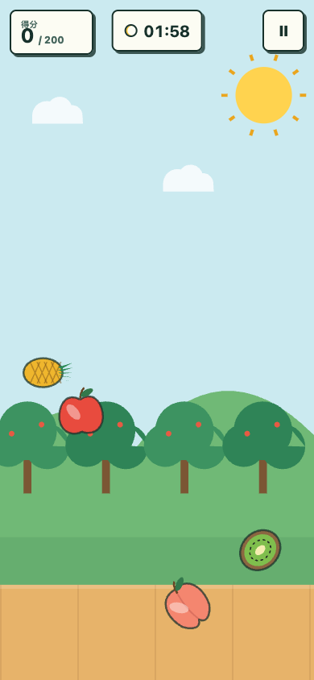

# Fruit Slice Party / 果切派对

[](https://github.com/kevinalliswell/fruit-slice-party/actions/workflows/ci.yml)
[](LICENSE)
[](package.json)

一款适合小朋友和全家休闲玩的单人切水果网页游戏。它支持触摸、鼠标和键盘，通过局域网即可在手机、平板和电脑上游玩。

A cheerful, single-player fruit slicing game for kids and families. It works with touch, mouse, and keyboard controls, and can be shared with phones and tablets over a local network.


<p align="center">
  
</p>

## Highlights / 特点

- Nine hand-drawn Canvas fruits with different scores / 9 种手绘 Canvas 水果与差异化分值
- Three difficulty levels with increasing speed and bomb frequency / 三档速度与炸弹密度
- Touch and mouse swipe detection with sliced fruit, juice, and explosion effects
- Generated Web Audio sound effects with mobile browser audio unlocking
- Responsive layouts for phones, tablets, and desktop browsers
- No accounts, database, analytics, external images, or runtime network dependencies

## Quick Start / 快速开始

Requirements: Node.js 20.19 or newer and npm.

```bash
git clone https://github.com/kevinalliswell/fruit-slice-party.git
cd fruit-slice-party
npm ci
npm run dev
```

Open `http://localhost:5190` on the computer. To play from another device, connect it to the same Wi-Fi and open the `Network` URL printed by Vite, for example `http://192.168.x.x:5190`.

电脑访问 `http://localhost:5190`。手机和平板连接同一 Wi-Fi 后，打开终端中 Vite 显示的 `Network` 地址。

## Game Rules / 游戏规则

| Mode / 难度 | Time / 时间 | Target / 目标 | Pace / 节奏 |
| --- | ---: | ---: | --- |
| Easy / 简单 | 2 minutes | 200 | Slow fruit, fewer bombs |
| Medium / 中等 | 5 minutes | 800 | Faster fruit, more bombs |
| Hard / 困难 | 10 minutes | 2000 | Fastest fruit, most bombs |

- Missing fruit has no penalty / 漏掉水果不扣分
- Slicing a bomb immediately ends the round and resets the score / 切到炸弹立即失败并清零
- Reaching the target wins immediately; otherwise the round ends when time expires

Fruit scores / 水果分数：梨 1、苹果 2、桃子 3、西瓜 5、菠萝 8、草莓 10、猕猴桃 10、香蕉 20、火龙果 50。

## Controls / 操作

- Touch: swipe across fruit
- Mouse: hold and drag across fruit
- Keyboard: `P` or `Esc` pauses and resumes the round

## Commands / 命令

| Command | Purpose |
| --- | --- |
| `npm run dev` | Start the LAN development server on port 5190 |
| `npm test` | Run rules, collision, and mobile audio tests |
| `npm run build` | Create the production build in `dist/` |
| `npm run preview` | Preview the production build over the LAN |
| `npm run check` | Run tests and the production build |

## Architecture / 项目结构

- `src/game-rules.js`: fruit scores, difficulty configuration, and pure round state
- `src/geometry.js`: swipe-to-circle collision detection
- `src/game-canvas.js`: spawning, physics, Pointer Events, and effects
- `src/fruit-art.js`: offline Canvas fruit and scene artwork
- `src/audio.js`: generated Web Audio effects and mobile audio unlocking
- `src/main.js`: menu, countdown, pause, timer, and result orchestration
- `test/`: Node.js built-in test suite

The game is intentionally client-only. It has no account system, persistence layer, or external runtime service, which keeps local play simple and makes static hosting straightforward.

## Contributing

Issues and pull requests are welcome. Read [CONTRIBUTING.md](CONTRIBUTING.md) before submitting a change. By participating, you agree to follow the [Code of Conduct](CODE_OF_CONDUCT.md).

Security issues should be reported privately as described in [SECURITY.md](SECURITY.md).

## License

Released under the [MIT License](LICENSE).
